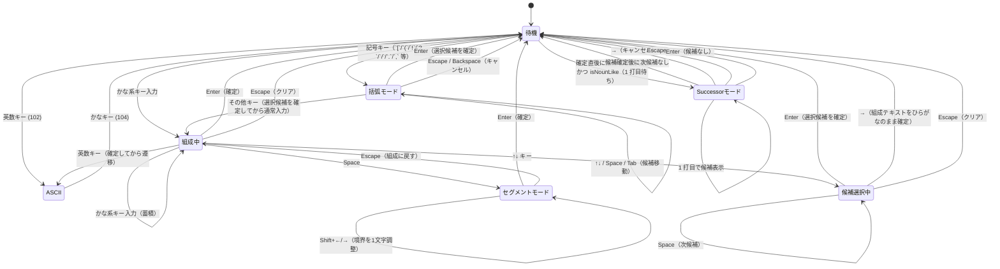

# keynaco 状態遷移

## 状態一覧

| 状態 | 条件 |
|------|------|
| **ASCII** | `isAsciiMode = true` |
| **待機** | `isAsciiMode = false`、組成空、特殊モードなし |
| **組成中** | `composedHiragana` または `pendingRomaji` が非空 |
| **候補選択中** | 組成中 + `isExplicitlySelected = true`（↑↓ 操作済み）|
| **括弧モード** | `bracketCandidates != nil`（組成空で `[`/`(`/`!`/`?`/`/`/`.`/`,` 等の記号キーを入力） |
| **セグメントモード** | `isSegmentMode = true` |
| **Successor 候補表示中** | `candidate.isVisible && composedHiragana.isEmpty` |

---

## 状態遷移図

---

## 状態ごとの主要キー動作

### 組成中

| キー | 動作 |
|------|------|
| かな系文字 | composedHiragana / pendingRomaji に蓄積 |
| `. / ,`（Shift なし） | `。`/`、` として composedHiragana に追加し候補ウィンドウを更新 |
| Space | `composedHiragana` 非空ならセグメントモードへ遷移。`composedHiragana` が空で `pendingRomaji` のみのときはキーを消費してマークドテキストを維持（本文へスペースは入れない） |
| ↑↓ | 候補選択中へ遷移 |
| Enter | 組成テキストをそのまま確定 |
| Escape | 組成クリア → 待機 |
| → | 組成テキストを確定（Enter と同じ） |
| 英数キー | 組成を確定してから ASCII モードへ |
| F6–F10 | ひらがな/カタカナ/ASCII 各形式で即時確定 |

*Tests: `Tests/InputHandlerCompositionTests.swift`*

### 候補選択中

| キー | 動作 |
|------|------|
| ↑↓ | 候補を移動 |
| Tab / Shift+Tab | 次候補 / 前候補へ移動 |
| Space | 次候補へ（ページ送り） |
| Enter | 選択候補を確定 → 待機 |
| → | 組成テキストをひらがなのまま確定 → 待機（選択候補は無視） |
| Escape | 組成クリア → 待機 |
| Backspace | 組成を1文字削除。1文字になった → `.dismiss`、2文字以上残る → `.show`（候補リフレッシュ） |
| Shift+Delete | 選択中の候補を履歴 DB から削除（`fixedEnd <= index < historyEnd` のときのみ有効。ユーザー辞書行・Zenzai プロモート行は `fixedEnd` 未満のため削除不可） |
| `. / ,`（Shift なし） | 選択候補を確定**せず**、`。`/`、` を組成に追加して候補をリフレッシュ |

*Tests: `Tests/InputHandlerCandidatesTests.swift`*

### 括弧モード

| キー | 動作 |
|------|------|
| ↑ / Shift+Tab | 前候補へ |
| ↓ / Space / Tab | 次候補へ |
| Enter | 選択候補を確定 → 待機 |
| Escape / Backspace | キャンセル（何も挿入しない）→ 待機 |
| その他キー | 選択候補を確定してから、そのキーを通常入力として処理 |

### セグメントモード

| キー | 動作 |
|------|------|
| ←/→ | フォーカス文節を前/次へ移動（候補ウィンドウが移動先文節の候補に切り替わる） |
| Space / Tab / ↓ | フォーカス文節の次候補へ |
| ↑ | フォーカス文節の前候補へ |
| Shift+→ | フォーカス文節を右に1文字拡張（次文節の先頭1文字を奪う） |
| Shift+← | フォーカス文節を左に1文字縮小（末尾1文字を次文節の先頭に渡す） |
| Enter | 全文節の選択候補を連結確定 → 待機 |
| Escape / Backspace | セグメントモード解除 → 組成に戻す |

セグメント突入時、AzooKey の `segmentize` で初期分割を表示する。手動境界調整（Shift+矢印）時は `isManuallyAdjusted` を立て、確定時に history へ二重記録する。

*Tests: `Tests/InputHandlerSegmentTests.swift`*

### Successor 候補表示中

| キー | 動作 |
|------|------|
| Space / Enter | 選択候補を確定（`confirmSuccessor`）→ 待機 |
| ↑↓ / Tab | 候補を移動 |
| ローマ字 2 文字目 | 1 打目を通常組成に流してから 2 打目を処理 |
| → / Escape / Backspace | 候補解除 → 待機 |

組成空で ASCII 英字 1 文字入力時、`trySuccessorCandidates` が候補を返せばこの状態に入る（確定直後の `successorEligible`、または `leftSideContext` 末尾の名詞文脈）。

*Tests: `Core/Sources/CoreTests/InputHandlerSuccessorTests.swift`*

---

## 補足

- **Successor の再帰防止**: 格助詞チェックは廃止。候補が空なら自然に `.dismiss` になるため、無限ループは起きない
- **Successor の文中挿入抑制**: カーソルが文末でない場合、`InputController.applyPostKeyDownEffects` が Successor 候補の `.show` を抑制する
- **候補取得**: `extractNounFromContext(leftSideContext)` または確定直後の `lastCommittedOutput`（`successorEligible`）を prev に noun-bigram + `fetchHistoryPrefix` を照会
- **確定直後 Backspace**: `penalizeAll` と同時に `successorEligible` をクリア（訂正意図の次打鍵で Successor を出さない）
- **Electron 対策**: Successor 候補選択中は `setMarkedText` に実テキストを渡す（空文字だと Enter がアプリ側に奪われる）
- **isAsciiMode は static**: アプリ切替後もモードを維持。テストの `setUp` でリセット必須
