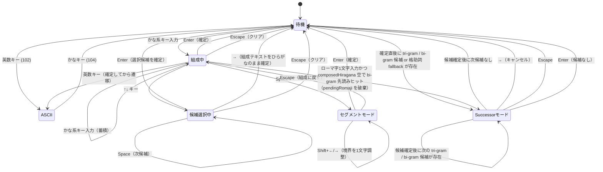

# keynaco 状態遷移

## 状態一覧

| 状態 | 条件 |
|------|------|
| **ASCII** | `isAsciiMode = true` |
| **待機** | `isAsciiMode = false`、組成空、特殊モードなし |
| **組成中** | `composedHiragana` または `pendingRomaji` が非空 |
| **候補選択中** | 組成中 + `isExplicitlySelected = true`（↑↓ 操作済み）|
| **セグメントモード** | `isSegmentMode = true` |
| **Successor モード** | `isSuccessorMode = true` |

---

## 状態遷移図

---

## 状態ごとの主要キー動作

### 組成中

| キー | 動作 |
|------|------|
| かな系文字 | composedHiragana / pendingRomaji に蓄積 |
| `. / ,`（Shift なし） | `。`/`、` として composedHiragana に追加し候補ウィンドウを更新 |
| Space | セグメントモードへ遷移 |
| ↑↓ | 候補選択中へ遷移 |
| Enter | 組成テキストをそのまま確定 |
| Escape | 組成クリア → 待機 |
| → | 組成テキストを確定（Enter と同じ） |
| 英数キー | 組成を確定してから ASCII モードへ |
| F6–F10 | ひらがな/カタカナ/ASCII 各形式で即時確定 |

*Tests: `Tests/InputHandlerCompositionTests.swift`*

### 候補選択中

| キー | 動作 |
|------|------|
| ↑↓ | 候補を移動 |
| Tab / Shift+Tab | 次候補 / 前候補へ移動 |
| Space | 次候補へ（ページ送り） |
| Enter | 選択候補を確定 → 待機 |
| → | 組成テキストをひらがなのまま確定 → 待機（選択候補は無視） |
| Escape | 組成クリア → 待機 |
| Backspace | 組成を1文字削除。1文字になった → `.dismiss`、2文字以上残る → `.show`（候補リフレッシュ） |
| Shift+Delete | 選択中の候補を履歴 DB から削除（`fixedEnd <= index < historyEnd` のときのみ有効。ユーザー辞書行は削除不可） |
| `. / ,`（Shift なし） | 選択候補を確定**せず**、`。`/`、` を組成に追加して候補をリフレッシュ |

*Tests: `Tests/InputHandlerCandidatesTests.swift`*

### セグメントモード

| キー | 動作 |
|------|------|
| ←/→ | フォーカス文節を前/次へ移動（候補ウィンドウが移動先文節の候補に切り替わる） |
| Space / Tab / ↓ | フォーカス文節の次候補へ |
| ↑ | フォーカス文節の前候補へ |
| Shift+→ | フォーカス文節を右に1文字拡張（次文節の先頭1文字を奪う） |
| Shift+← | フォーカス文節を左に1文字縮小（末尾1文字を次文節の先頭に渡す） |
| Enter | 全文節の選択候補を確定 → 待機 |
| Escape / Backspace | セグメントモード解除 → 組成に戻す |

*Tests: `Tests/InputHandlerSegmentTests.swift`*

### Successor モード

| キー | 動作 |
|------|------|
| Space / Enter | 選択候補を確定 → 次の Successor 候補があれば継続、なければ待機 |
| ↑↓ | 候補を移動 |
| Tab | 次候補へ |
| ローマ字 1 文字（格助詞 fast-path, 名詞末尾時のみ） | `particleRomajiMap` で格助詞サブセットに絞り込み |
| 非対応キー（1 打目, `pendingSuccessorCandidates` あり） | `romajiToInitialKana` で読みフィルタ→一致候補を表示。一致なしはモード解除 |
| 非対応キー（1 打目, `pendingSuccessorCandidates` なし） | バッファがあれば流す → モード解除 → 通常組成へ |
| → | モードキャンセル → 待機（successorFirstChar は破棄） |
| Escape / Backspace | モード解除 → 待機 |

*Tests: `Tests/InputHandlerSuccessorTests.swift`*

---

## 補足

- **Successor の再帰防止**: 格助詞チェックは廃止。候補が空なら自然に `.dismiss` になるため、無限ループは起きない
- **候補取得の優先順位**: `prev2Output`（2語前）× `lastCommittedOutput`（1語前）で trigram を引き、なければ `lastCommittedOutput` だけで bigram をフォールバック
- **fallback の条件**: `isNounLike(last)` が真のとき限定で、予測候補（trigram + bigram）の後ろに格助詞固定リストを並べる
- **N-gram 遅延表示と読みフィルタ**: N-gram 候補がある場合、確定直後は候補ウィンドウを閉じ（`.dismiss`）`pendingSuccessorCandidates` に保存。1打目の入力で `romajiToInitialKana` によるかな先頭一致フィルタを行い、一致候補のみ表示する。一致なしはモード解除して通常入力に流す（格助詞のみの場合は従来通り即時表示）
- **pendingRomaji 先読み予測**: Successor モード外で `composedHiragana` が空かつ `pendingRomaji` が1文字（`n` を除く）のとき `buildPendingCandidateList` が bi-gram/trigram/skip-bigram を先読みし、候補があれば `isSuccessorMode = true` へ移行。`n` は `ん` との曖昧さがあるため除外。候補ゼロなら `pendingRomaji` はそのまま通常組成を続ける
- **Electron 対策**: 候補選択中は `setMarkedText` に実テキストを渡す（空文字だと Enter がアプリ側に奪われる）
- **isAsciiMode は static**: アプリ切替後もモードを維持。テストの `setUp` でリセット必須
- **ASCII モードの F キー**: F6–F10 は ASCII モード中では無効（組成が空のため）
- **セグメント境界学習**: Shift+矢印で手動調整した境界は、確定時に `boundary_pref` テーブルへ保存される。次回同じ読みで Space を押すと AzooKey の初期分割より保存済み境界が優先される
- **日時候補**: 読みが `きょう` / `いま` / `ことし` 等のとき、`historyEnd` の直後（AzooKey 辞書候補の前）に日付・時刻・年の文字列を動的に追加（`InputHandler.generateDateTimeCandidates(for:)`）。確定しても history / bigram / trigram には記録しない
- **セグメントモードのテスト**: `Tests/InputHandlerSegmentTests.swift`
- **ASCII モードのテスト**: `Tests/InputHandlerAsciiTests.swift`
