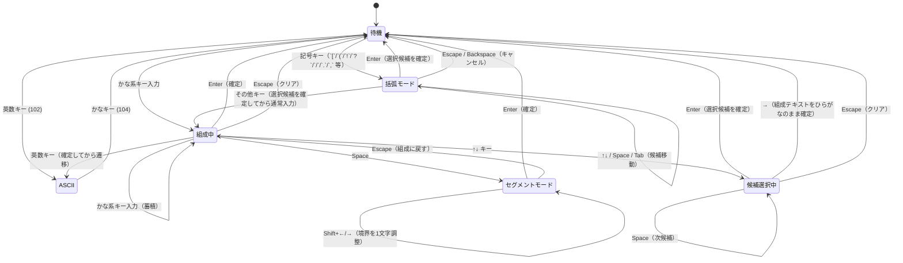

# keynaco 状態遷移

状態の定義と遷移条件のみ。各状態のキー動作詳細は `InputHandler+*.swift` と対応するテスト（`Tests/InputHandler*.swift`）が正本。

## 状態一覧

| 状態 | 条件 |
|------|------|
| **ASCII** | `isAsciiMode = true` |
| **待機** | `isAsciiMode = false`、組成空、特殊モードなし |
| **組成中** | `composedHiragana` または `pendingRomaji` が非空 |
| **候補選択中** | 組成中 + `isExplicitlySelected = true`（↑↓ 操作済み）|
| **括弧モード** | `bracketCandidates != nil`（組成空で `[`/`(`/`!`/`?`/`/`/`.`/`,` 等の記号キーを入力） |
| **セグメントモード** | `isSegmentMode = true` |

## 状態遷移図

## 注意点

- **`isAsciiMode` は static**: アプリ切替後もモードを維持。テストの `setUp` でリセット必須
- **キー動作詳細**: 各状態の細かいキー動作（Backspace の挙動・候補選択中の `.` `,` での組成追加など）は `InputHandler+*.swift` および対応テストを参照。ここに書くと drift する
