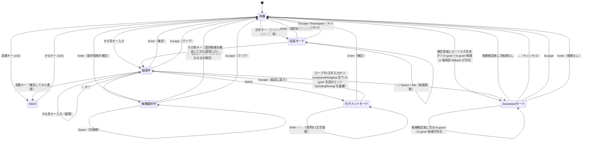

# keynaco 状態遷移

## 状態一覧

| 状態 | 条件 |
|------|------|
| **ASCII** | `isAsciiMode = true` |
| **待機** | `isAsciiMode = false`、組成空、特殊モードなし |
| **組成中** | `composedHiragana` または `pendingRomaji` が非空 |
| **候補選択中** | 組成中 + `isExplicitlySelected = true`（↑↓ 操作済み）|
| **括弧モード** | `bracketCandidates != nil`（組成空で `[`/`(`/`!`/`?`/`/`/`.`/`,` 等の記号キーを入力） |
| **セグメントモード** | `isSegmentMode = true` |
| **Successor モード** | `isSuccessorMode = true` |

---

## 状態遷移図

---

## 状態ごとの主要キー動作

### 組成中

| キー | 動作 |
|------|------|
| かな系文字 | composedHiragana / pendingRomaji に蓄積 |
| `. / ,`（Shift なし） | `。`/`、` として composedHiragana に追加し候補ウィンドウを更新 |
| Space | `composedHiragana` 非空ならセグメントモードへ遷移。`composedHiragana` が空で `pendingRomaji` のみのときはキーを消費してマークドテキストを維持（本文へスペースは入れない） |
| ↑↓ | 候補選択中へ遷移 |
| Enter | 組成テキストをそのまま確定 |
| Escape | 組成クリア → 待機 |
| → | 組成テキストを確定（Enter と同じ） |
| 英数キー | 組成を確定してから ASCII モードへ |
| F6–F10 | ひらがな/カタカナ/ASCII 各形式で即時確定 |

*Tests: `Tests/InputHandlerCompositionTests.swift`*

### 候補選択中

| キー | 動作 |
|------|------|
| ↑↓ | 候補を移動 |
| Tab / Shift+Tab | 次候補 / 前候補へ移動 |
| Space | 次候補へ（ページ送り） |
| Enter | 選択候補を確定 → 待機 |
| → | 組成テキストをひらがなのまま確定 → 待機（選択候補は無視） |
| Escape | 組成クリア → 待機 |
| Backspace | 組成を1文字削除。1文字になった → `.dismiss`、2文字以上残る → `.show`（候補リフレッシュ） |
| Shift+Delete | 選択中の候補を履歴 DB から削除（`fixedEnd <= index < historyEnd` のときのみ有効。ユーザー辞書行・Zenzai プロモート行は `fixedEnd` 未満のため削除不可） |
| `. / ,`（Shift なし） | 選択候補を確定**せず**、`。`/`、` を組成に追加して候補をリフレッシュ |

*Tests: `Tests/InputHandlerCandidatesTests.swift`*

### 括弧モード

| キー | 動作 |
|------|------|
| ↑ / Shift+Tab | 前候補へ |
| ↓ / Space / Tab | 次候補へ |
| Enter | 選択候補を確定 → 待機 |
| Escape / Backspace | キャンセル（何も挿入しない）→ 待機 |
| その他キー | 選択候補を確定してから、そのキーを通常入力として処理 |

### セグメントモード

| キー | 動作 |
|------|------|
| ←/→ | フォーカス文節を前/次へ移動（候補ウィンドウが移動先文節の候補に切り替わる） |
| Space / Tab / ↓ | フォーカス文節の次候補へ |
| ↑ | フォーカス文節の前候補へ |
| Shift+→ | フォーカス文節を右に1文字拡張（次文節の先頭1文字を奪う） |
| Shift+← | フォーカス文節を左に1文字縮小（末尾1文字を次文節の先頭に渡す） |
| Enter | 通常は全文節の選択候補を連結確定 → 待機。`llmWholeText` が設定済みかつ短絡確定条件を満たすときは LLM 全文のみを 1 回確定する（条件詳細: `isLlmWholeTextShortcut`。満たさない場合は通常確定へフォールスルー） |
| Escape / Backspace | セグメントモード解除 → 組成に戻す |

セグメント突入時、`InputController` がオンデバイス LLM で読み全体の一括変換を非同期開始する。AzooKey の初期分割は突入直後にそのまま表示される。LLM 結果が返れば `inferSegmentBoundaries` でアライメントを試み、成功時は文節境界と候補列を再構築（`llmWholeText` を設定）、失敗時は Zenzai 無効なら先頭文節に全文を挿入し Zenzai 有効なら候補列を維持する。`inferSegmentBoundaries` が 2 ペア以上で成功した確定では境界を `boundary_pref` に保存する。

*Tests: `Tests/InputHandlerSegmentTests.swift`、`Tests/InputHandlerSegmentLLMTests.swift`、`Tests/SegmentBoundaryTests.swift`*

### Successor モード

| キー | 動作 |
|------|------|
| Space / Enter | 選択候補を確定 → 次の Successor 候補があれば継続、なければ待機。`selectedText` が得られないときは Successor を解除し `composingText`（`pendingRomaji` 含む）を再表示 |
| ↑↓ | 候補を移動 |
| Tab | 次候補へ |
| ローマ字 1 文字（`pendingSuccessorCandidates` あり） | `romajiToInitialKana` で DB 再照会＋**保留リスト**の `mergePendingSuccessorMatches` 併合＋`particleRomajiMap` で当たる格助詞を追加→一致候補を表示し、末尾に `successorLLMSurfaceExtras` を連結→**`expandSuccessorPrefixes`** で長い表層を助詞境界 prefix に展開して `.show`（最大 5 件）。一致なしはモード解除 |
| 非対応キー（1 打目, `pendingSuccessorCandidates` なし） | バッファがあれば流す → モード解除 → 通常組成へ |
| → | モードキャンセル → 待機（successorFirstChar は破棄） |
| Escape / Backspace | モード解除 → 待機 |

*Tests: `Tests/InputHandlerSuccessorTests.swift`*

---

## 補足

- **Successor の再帰防止**: 格助詞チェックは廃止。候補が空なら自然に `.dismiss` になるため、無限ループは起きない
- **Successor の文中挿入抑制**: カーソルが文末でない（文中挿入モード）場合、`suggestSuccessors()` は Successor モードに入らず `.dismiss` を返す
- **候補取得の優先順位**: `prev2Output`（2語前）× `lastCommittedOutput`（1語前）で trigram を引き、なければ `lastCommittedOutput` だけで bigram をフォールバック。`committedHistory` が空のときは IMK `before` 由来の `virtualHistoryPrefix` で prev を補完する（学習経路は対象外）
- **fallback の条件**: `isNounLike(last)` が真のとき限定で、予測候補（trigram + bigram）の後ろに格助詞固定リストを並べる
- **N-gram 遅延表示**: 確定直後は常に候補ウィンドウを閉じ 1 打目待ち。1 打目でかな先頭一致で DB を再照会し、`pendingSuccessorCandidates` 内の語を併合し、`successorLLMSurfaceExtras`（LLM 表層形）を末尾に連結したあと `expandSuccessorPrefixes` で長い候補を部分表層に展開して表示する（元の全体候補は必ず残す）
- **pendingRomaji 先読み予測**: Successor モード外で `composedHiragana` が空かつ `pendingRomaji` が1文字（`n` を除く）のとき noun-bigram/bi-gram/trigram を先読みし、候補があれば Successor モードへ移行
- **Electron 対策**: 候補選択中は `setMarkedText` に実テキストを渡す（空文字だと Enter がアプリ側に奪われる）
- **isAsciiMode は static**: アプリ切替後もモードを維持。テストの `setUp` でリセット必須
- **セグメント境界学習**: Shift+矢印で手動調整した境界、または LLM 2ペア以上の再構築成功確定では `boundary_pref` へ保存される。次回同じ読みで Space を押すと保存済み境界が優先される
