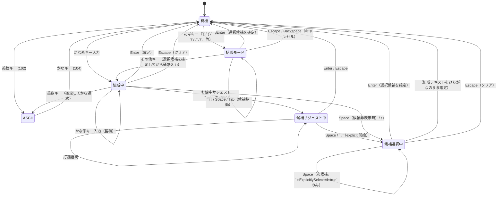
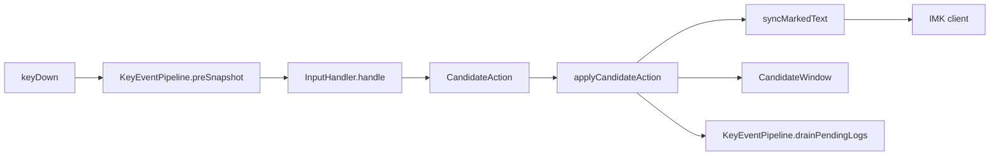

# keynaco 状態遷移

状態の定義と遷移条件のみ。各状態のキー動作詳細は `InputHandler+*.swift` と対応するテスト（`Tests/InputHandler*.swift`）が正本。

## 状態一覧

| 状態 | 条件 |
|------|------|
| **ASCII** | `isAsciiMode = true` |
| **待機** | `isAsciiMode = false`、組成空、特殊モードなし |
| **組成中** | `composedHiragana` または `pendingRomaji` が非空 |
| **候補サジェスト中** | 組成中 + 候補窓表示 + `isExplicitlySelected = false`（`.passive`） |
| **候補選択中** | 組成中 + `isExplicitlySelected = true`（`.explicit`。↑↓ / Tab / Space リビルド後）|
| **括弧モード** | `CandidateSession.bracketCandidates != nil`（`InputHandler.candidateSession`。組成空で `[`/`(`/`!`/`?`/`/`/`.`/`,` 等の記号キーを入力） |

## 状態遷移図

**Space の補足**: 候補窓表示中でも `isExplicitlySelected=false`（`.passive`）なら Space は次候補ではなく explicit リビルド。↑↓ / Tab で explicit 移行後の Space のみ次候補。

## キー処理パイプライン（候補・marked text）

`KeyEventPipeline` が `InputController` / sandbox / benchmark で共通の keyDown 手順を担う。`preSnapshot` で pre 状態を固定してから `handle()` を呼び、確定後に `drainPendingLogs` でセッション・ divergence ログを回収する。

`InputHandler` はキー → `CandidateAction` のみ返す。IMK への marked text 反映と候補ウィンドウ更新は `InputController` に集約する。

## キー分岐モード（`KeyDispatchMode`）

`KeyDispatch.route` が使う操作モードの簡略版。上記「状態一覧」の粗いグルーピングに対応するが、候補サジェスト中（`.passive`）と候補選択中（`.explicit`）はどちらも `.candidatePanel`。明示選択の有無は `CandidateContext` 側で扱う。

| `KeyDispatchMode` | 導出条件（`KeyDispatchInput.make`） |
|-------------------|-----------------------------------|
| `.bracket` | `CandidateSession.bracketCandidates != nil` |
| `.ascii` | `isAsciiMode` |
| `.candidatePanel` | 候補窓表示中（`candidateVisible`） |
| `.composing` | 組成中（読み or pending ローマ字が非空）かつ上記以外 |
| `.idle` | 待機 |

## 主要な語彙と対応するコード概念

| 用語 | コード上の名前 | 意味 |
|------|--------------|------|
| 読み全体 | `CompositionState.composingText` | `composedHiragana + pendingRomaji`。ユーザーが打っている途中の読み。マークドテキストの表示にも使う |
| 確定テキスト | `CompositionState.finalizedText` | Enter 確定時に送出するテキスト。pending "n" は "ん" に強制変換 |
| ひらがな部分 | `CompositionState.composedHiragana` | ローマ字変換済み部分。AzooKey へ渡す読みはこちら |
| 未確定ローマ字 | `CompositionState.pendingRomaji` | まだひらがなに変換されていないローマ字（例: `k`・`sh` 途中） |
| 確定経路 | `CommitTrigger` | 確定の起因（`.enter`・`.rightArrow`・`.modeSwitch`・`.deactivate`）。`commitComposition` の呼び出し側が明示する |
| 候補フェーズ | `CandidatePanelInteraction` | `isVisible × isExplicitlySelected` から導出される3状態（`.hidden` / `.passive` / `.explicit`）。パネルの表示有無と操作種別を一元化する |
| 行セクション | `CandidateRowSection` | 候補行の UI 区分（`.fixed` / `.history` / `.dictionary`）。`ScoredCandidate.Source`（`candidateSources`）から導出。Shift+Delete 可否と区切り線描画の基準 |
| 構築トリガー | `CandidateListTrigger` | `buildCandidateList(for:azooKey:)` の呼び出し起因（`.whileTyping` / `.explicit`）。候補フェーズとは別概念 |
| キー分岐モード | `KeyDispatchMode` | `KeyDispatch.route` の分岐用。`.passive` / `.explicit` はどちらも `.candidatePanel` |
| 候補先行表示 | `AzooKeyCachePeek` | AzooKey の非同期変換結果が届く前に、直前のキャッシュ（完全一致 or 短い読みの prefix）を暫定候補として即時表示する仕組み。完全一致ヒット時は非同期リクエストを省略する |
| 候補ランキング | `azooKeyApiOrder` | Zenzai（zenz-v3）が推論した候補の並び順。AzooKey が候補テキストを生成し、Zenzai がその順位を決める。keynaco 側では `CandidateScoreBuilder` が AzooKey rank スコアと exact 履歴の Zenzai tie-break に使う |

## 候補フェーズの詳細

`CandidatePanelInteraction` は `CandidateSession.panelInteraction` プロパティで導出する。

| フェーズ | `isVisible` | `isExplicitlySelected` | 文字キーの挙動 |
|----------|-------------|------------------------|--------------|
| `.hidden` | false | false | 通常入力 |
| `.passive` | true | false | 通常入力（サジェスト表示のみ） |
| `.explicit` | true | true | 先に選択候補を確定してから入力 |

`.passive` に遷移するのは `.whileTyping` トリガーの `buildCandidateList` 経由のみ。Space（候補非表示時）・↑↓ は `.explicit` で開始する。候補窓が `.passive` のまま表示中に Space を押すと explicit リビルド（次候補ではない）。

## 候補リストのセクション構造

候補列は `CandidateScoreBuilder` のスコア降順で flatten される。各行の `ScoredCandidate.Source`（`candidateSources`）が正本。

| 行セクション | 判定（`CandidateRowMetadata.section(for:)`） | Shift+Delete |
|-------------|---------------------------------------------|-------------|
| `.fixed` | `hiraganaBuiltin` / `hiraganaPreferred` | 不可 |
| `.history` | `historyExact` / `historyPrefix` | 可 |
| `.dictionary` | 上記以外（`userDict`・`azooKey`・`number`・`dateTime` 等） | 不可 |

スコアの概略（詳細は `CandidateScoreBuilder` の `///`）:

| source | スコア目安 |
|--------|-----------|
| ユーザー辞書 exact | 50 |
| ユーザー辞書 prefix | 30 |
| ひらがな builtin bonus | 80 |
| ひらがな preferred bonus | 100 |
| 履歴（DB スコア + 表示 floor） | DB 値、最低 AzooKey rank 0 超 |
| AzooKey rank *n* | `10 / (1 + n)` |
| 数値 / 日時 | 5 |

`fixedEnd` は先頭から連続する hiragana preferred 行数（Zenzai プロモート診断用）。sandbox / Debug JSON では `candidateEntries[].section` を見る。

## 注意点

- **`isAsciiMode` はインスタンス**: `InputHandler` ごとに保持。アプリ切替後も同一 `handler` インスタンスならモードを維持
- **キー動作詳細**: 各状態の細かいキー動作（Backspace の挙動・候補選択中の `.` `,` での組成追加など）は `InputHandler+*.swift` および対応テストを参照。ここに書くと drift する
