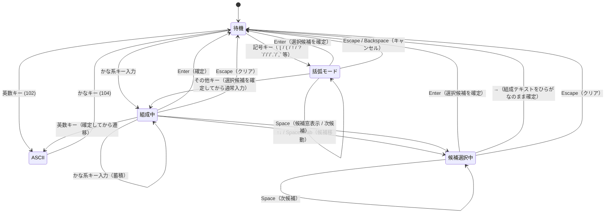
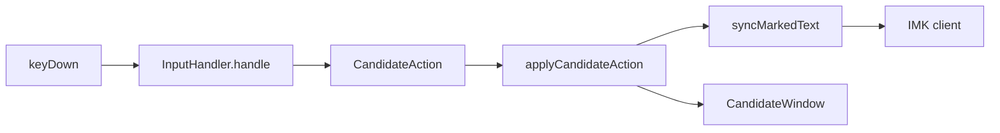

# keynaco 状態遷移

状態の定義と遷移条件のみ。各状態のキー動作詳細は `InputHandler+*.swift` と対応するテスト（`Tests/InputHandler*.swift`）が正本。

## 状態一覧

| 状態 | 条件 |
|------|------|
| **ASCII** | `isAsciiMode = true` |
| **待機** | `isAsciiMode = false`、組成空、特殊モードなし |
| **組成中** | `composedHiragana` または `pendingRomaji` が非空 |
| **候補選択中** | 組成中 + `isExplicitlySelected = true`（↑↓ 操作済み）|
| **括弧モード** | `CandidateSession.bracketCandidates != nil`（`InputHandler.candidateSession`。組成空で `[`/`(`/`!`/`?`/`/`/`.`/`,` 等の記号キーを入力） |

## 状態遷移図

## キー処理パイプライン（候補・marked text）

`InputHandler` はキー → `CandidateAction` のみ返す。IMK への marked text 反映と候補ウィンドウ更新は `InputController` に集約する。

## 主要な語彙と対応するコード概念

| 用語 | コード上の名前 | 意味 |
|------|--------------|------|
| 読み全体 | `CompositionState.composingText` | `composedHiragana + pendingRomaji`。ユーザーが打っている途中の読み。マークドテキストの表示にも使う |
| 確定テキスト | `CompositionState.finalizedText` | Enter 確定時に送出するテキスト。pending "n" は "ん" に強制変換 |
| ひらがな部分 | `CompositionState.composedHiragana` | ローマ字変換済み部分。AzooKey へ渡す読みはこちら |
| 未確定ローマ字 | `CompositionState.pendingRomaji` | まだひらがなに変換されていないローマ字（例: `k`・`sh` 途中） |
| 確定経路 | `CommitTrigger` | 確定の起因（`.enter`・`.rightArrow`・`.modeSwitch`・`.deactivate`）。`commitComposition` の呼び出し側が明示する |
| 候補フェーズ | `CandidatePanelInteraction` | `isVisible × isExplicitlySelected` から導出される3状態（`.hidden` / `.passive` / `.explicit`）。パネルの表示有無と操作種別を一元化する |
| 行セクション | `CandidateRowSection` | 候補リストを `fixedEnd` / `historyEnd` で3ゾーンに分割した区分（`.fixed` / `.history` / `.dictionary`）。Shift+Delete 可否と区切り線描画の基準 |
| 構築トリガー | `CandidateListTrigger` | `buildCandidateList` の呼び出し起因（`.whileTyping` / `.explicit`）。候補フェーズとは別概念 |
| 候補先行表示 | `AzooKeyCachePeek` | AzooKey の非同期変換結果が届く前に、直前のキャッシュ（完全一致 or 短い読みの prefix）を暫定候補として即時表示する仕組み。完全一致ヒット時は非同期リクエストを省略する |
| 候補ランキング | `azooKeyApiOrder` | Zenzai（zenz-v3）が推論した候補の並び順。AzooKey が候補テキストを生成し、Zenzai がその順位を決めるという役割分担を指す。keynaco 側では「AzooKey からもらった順番列」として扱い、`CandidateSectionBuilder` が exactMatchHistory のソートと azooKeyDict の並びに適用する |

## 候補フェーズの詳細

`CandidatePanelInteraction` は `CandidateSession.panelInteraction` プロパティで導出する。

| フェーズ | `isVisible` | `isExplicitlySelected` | 文字キーの挙動 |
|----------|-------------|------------------------|--------------|
| `.hidden` | false | false | 通常入力 |
| `.passive` | true | false | 通常入力（サジェスト表示のみ） |
| `.explicit` | true | true | 先に選択候補を確定してから入力 |

`.passive` に遷移するのは `.whileTyping` トリガーの `buildCandidateList` 経由のみ。Space（候補非表示時）・↑↓ は `.explicit` で開始する。

## 候補リストのセクション構造

候補リストは2つの整数インデックス `fixedEnd` / `historyEnd` で3ゾーンに分割される（`CandidateLayout` が保証する不変条件: `0 <= fixedEnd <= historyEnd <= candidates.count`）。

| 行セクション | 行範囲 | 内容 | Shift+Delete |
|-------------|--------|------|-------------|
| `.fixed` | `row < fixedEnd` | ひらがな固定・ユーザー辞書 | 不可 |
| `.history` | `fixedEnd <= row < historyEnd` | 高スコア履歴 | 可 |
| `.dictionary` | `row >= historyEnd` | AzooKey辞書・数値・日時・カタカナ | 不可 |

`CandidateLayout` はビルド時に `CandidateSection.Kind`（8種）を `sectionOrder` に従って平坦化してからインデックスを確定する。各 Kind と行セクションの対応は下表のとおり。

| `CandidateSection.Kind` | 行セクション | 備考 |
|------------------------|-------------|------|
| `.fixedHiragana` | fixed | `hiraganaPreferred` 時の先頭固定 |
| `.userDict` | fixed | ユーザー辞書 |
| `.exactMatchHistory` | history | 読み完全一致履歴。Zenzai 順でソート後に先頭へ |
| `.highHistory` | history | 前方一致などその他高スコア履歴 |
| `.number` | dictionary | 数値変換 |
| `.dateTime` | dictionary | 日時変換 |
| `.azooKeyDict` | dictionary | AzooKey 辞書候補（Zenzai 推論結果込み） |
| `.katakana` | dictionary | カタカナ変換（末尾固定） |

## 注意点

- **`isAsciiMode` は static**: アプリ切替後もモードを維持。テストの `setUp` でリセット必須
- **キー動作詳細**: 各状態の細かいキー動作（Backspace の挙動・候補選択中の `.` `,` での組成追加など）は `InputHandler+*.swift` および対応テストを参照。ここに書くと drift する
